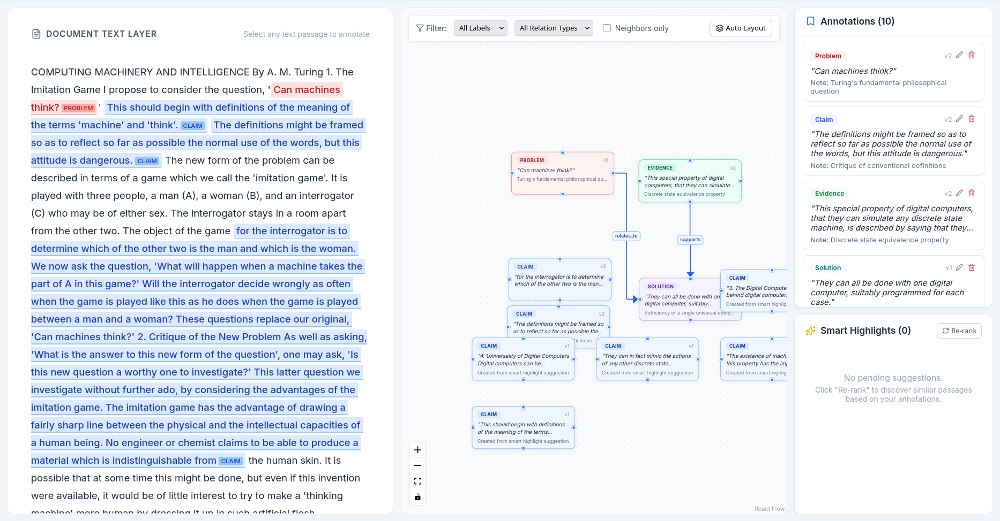
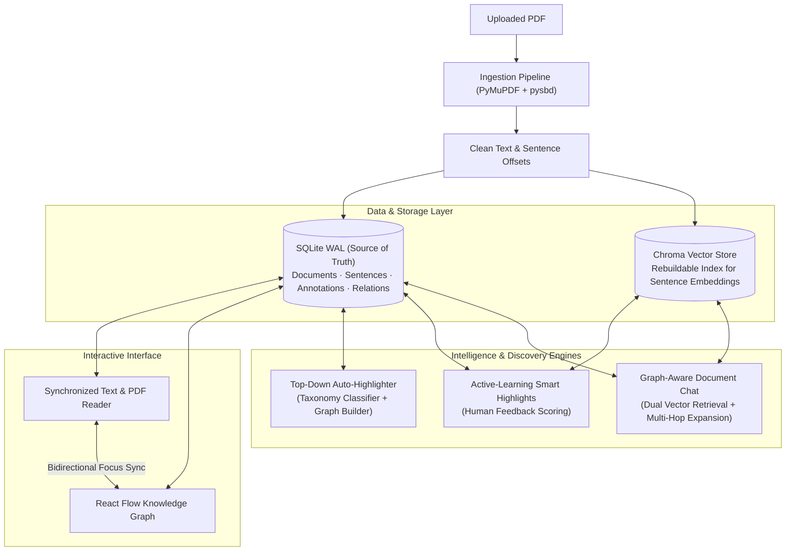

# DocuMesh

**DocuMesh** transforms static text PDFs into structured, interactive relational knowledge graphs. Instead of passively reading linear text, users can highlight concepts, map directional relationships across passages, receive active-learning highlight suggestions, automatically annotate entire documents top-down, and query the document using graph-augmented chat.



---

## Architecture & Design

DocuMesh is designed around a single guiding principle: **the graph is a live, typed view over raw document text**, not an isolated or synthetic structure.



### Core Design Principles
1. **Verbatim Text Grounding**: Every node in the knowledge graph maps to exact character start and end offsets (`start`, `end`) in the cleaned document text. Quotes are automatically snapped to word boundaries and verified against document text.
2. **SQLite as the Authoritative Core**: All annotations, relations, and embeddings are stored durably in SQLite. Vector databases (Chroma) act as disposable, rebuildable acceleration indices.
3. **Human-in-the-Loop Active Learning**: Suggested highlights are never hallucinated. The recommendation engine scores verbatim document sentences against user seeds, incorporates negative feedback from rejections, and maintains diversity using Maximal Marginal Relevance (MMR).
3. **Human-in-the-Loop Active Learning**: Suggested highlights are never hallucinated. The recommendation engine scores verbatim document sentences against user seeds and incorporates negative feedback from rejections.
4. **Optimistic Locking & Concurrency**: Annotations and relations utilize version-tracked optimistic locking (`version_id_col`), returning `409 Conflict` on concurrent or stale edits.
5. **Resilient Reconnection**: The frontend includes automatic health polling and query backoff, seamlessly reconnecting when the backend restarts without losing local state.

---

## Key Features

### 1. Interactive Document Mesh (Knowledge Graph)
- **Visual Canvas**: Powered by React Flow and Dagre layout, rendering annotations as concept cards and relations as directed semantic arrows.
- **Taxonomy Driven**: Seeded taxonomy categories (`Claim`, `Evidence`, `Definition`, `Method`, `Result`, `Problem`, `Solution`) and relationship types (`supports`, `refutes`, `defines`, `elaborates`, `causes`, `solves`, `similar_to`, `contrasts_with`, `conditional_on`, `precedes`).
- **Ghost Suggestion Nodes**: Pending AI suggestions render as semi-transparent "ghost nodes" directly in the graph canvas with inline match scores and one-click Accept/Reject controls.
- **Relational Integrity**: Enforces strict cycle prevention, disallows self-referential links, and cascades edge deletion when an annotation is deleted.

### 2. Dual-View Synchronized Reader
- **Inline Highlighting**: Renders non-overlapping inline `<mark>` tags styled with high-contrast taxonomy badges directly over the text.
- **Bidirectional Graph Synchronization**:
  - Clicking any highlight in the reader centers and selects its node in the graph view.
  - Clicking a node in the graph view scrolls the reader smoothly to the exact passage and flashes the highlight.
- **Multi-Layering & Overlaps**: Fully supports overlapping character spans, allowing users to toggle between overlapping annotations in the details drawer.
- **PDF Mode Toggle**: Instantly switch between the native structured text reader and the original rendered PDF canvas.

### 3. Top-Down Full Document Auto-Highlighting
- **End-to-End Extraction**: Sweeps through an entire PDF in document order to construct an end-to-end knowledge graph with a single click.
- **Batch Classification**: Analyzes sentence chunks against the project taxonomy using either an LLM or local zero-shot prototype vector embeddings.
- **Calibrated Prototype Fallback**: If an LLM is offline or uncredited, the engine automatically falls back to embedding prototype classification with calibrated similarity scoring (`AUTO_HIGHLIGHT_PROTO_THRESHOLD = 0.18`), ensuring highlights are generated without API dependencies.
- **Automated Relational Pairing**: Automatically pairs and types relationships (`solves`, `supports`, `defines`, `causes`) across discovered concepts.
- **Background Job Tracking**: Runs asynchronously with live percentage progress tracking (`GET /jobs/{id}`) and non-blocking background workers.

### 4. Scoped Smart Highlights (Active Learning)
- **Context-Aware Scoping**:
  - **This passage**: Recommends sentences semantically similar to a specific selected annotation.
  - **This category**: Recommends sentences matching the conceptual label across the entire document.
- **Negative Feedback Loop**: Rejecting a suggestion penalizes similar candidates under that category (`NEG_WEIGHT = 0.5`) without penalizing other labels.
- **MMR Diversity**: Uses Maximal Marginal Relevance (`MMR_LAMBDA = 0.7`) to prune redundant sentences and surface diverse, high-value highlights.
- **Atomic Acceptance**: Accepting a suggestion promotes it to a confirmed annotation and links it to the seed node in a single database transaction.

### 5. Graph-Aware Document Chat
- **Topological Grounding**: Combines text sentence retrieval with knowledge graph traversal up to $N$ neighbor hops (`CHAT_NEIGHBOR_HOPS = 2`).
- **Strict Citation Validation**: The LLM must cite its findings using bracketed tokens (`[s1]` for sentences, `[a2]` for annotations, `[r3]` for relations). The server verifies each citation against the context budget before returning the response.
- **Interactive Citation Chips**: Citations in chat messages appear as clickable chips. Clicking a citation jumps directly to the text in the reader and focuses the corresponding node or edge in the graph.
- **One-Click Promotion**: Save any sentence cited during chat as a new permanent annotation with one click.

---

## Technology Stack

| Layer | Technologies |
|---|---|
| **Backend** | Python 3.12+, FastAPI, SQLAlchemy (SQLite WAL mode), PyMuPDF (`fitz`), `pysbd`, `sentence-transformers`, `fastembed`, `numpy` |
| **Vector Index** | Chroma (`chromadb`) with rebuildable SQLite vector BLOB backup |
| **Frontend** | React 19, Vite, React Flow (`reactflow`), Dagre, TanStack Query (`@tanstack/react-query`), Lucide Icons |
| **LLM Services** | Hugging Face Serverless (`huggingface_hub`), OpenAI API, or Deterministic Fake Client |
| **Testing** | `pytest` (Backend - 80 tests), `vitest` (Frontend - 54 tests) |

---

## Quick Start

### Prerequisites
- Python 3.12+
- Node.js 18+ and `npm`

### 1. Clone & Configure
```bash
git clone https://github.com/your-username/documesh.git
cd documesh
cp .env.example .env
```

### 2. Backend Setup
```bash
# Create and activate virtual environment
python3 -m venv .venv
source .venv/bin/activate

# Install dependencies
pip install -r backend/requirements.txt

# Start backend server
uvicorn backend.app.main:app --port 8000 --reload
```
The API documentation is available at [http://localhost:8000/docs](http://localhost:8000/docs).

### 3. Frontend Setup
In a new terminal window:
```bash
cd frontend
npm install
npm run dev
```
Open [http://localhost:5173](http://localhost:5173) in your browser.

### 4. Seed Demo Data (Optional)
To pre-populate a sample document with annotations and relations:
```bash
python backend/seed.py
```

---

## Configuration Reference

All application parameters are configured via environment variables in `.env`:

| Variable | Default | Purpose |
|---|---|---|
| `DATABASE_URL` | `sqlite:///./data/app.db` | SQLAlchemy database connection string |
| `DB_PATH` | `./data/app.db` | SQLite database file location |
| `UPLOAD_DIR` | `./uploads` | Storage directory for uploaded PDF files |
| `MAX_UPLOAD_MB` | `15` | Maximum PDF file upload size limit (MB) |
| `MAX_PDF_PAGES` | `50` | Maximum page count allowed per document |
| `EMBEDDING_MODEL_NAME` | `all-MiniLM-L6-v2` | Sentence-transformers model identifier |
| `VECTOR_STORE` | `chroma` | Vector index implementation (`chroma` or `fake`) |
| `VECTOR_STORE_PATH` | `./data/chroma` | Persistent Chroma storage directory |
| `SIMILARITY_THRESHOLD` | `0.35` | Minimum cosine similarity score for suggestions |
| `SUGGESTION_COUNT` | `5` | Maximum suggestions returned per recommendation run |
| `NEG_WEIGHT` | `0.5` | Penalty factor for rejected suggestions |
| `MMR_LAMBDA` | `0.7` | MMR balance (0 = maximum diversity, 1 = maximum relevance) |
| `AUTO_HIGHLIGHT_BATCH_SIZE` | `20` | Sentence chunk batch size during auto-highlighting |
| `AUTO_HIGHLIGHT_MAX_PAIRS` | `100` | Max candidate pairs evaluated for full graph building |
| `AUTO_HIGHLIGHT_PROTO_THRESHOLD` | `0.18` | Minimum similarity floor for zero-shot prototype fallback |
| `LLM_PROVIDER` | `fake` | LLM client backend: `fake`, `huggingface`, or `openai` |
| `LLM_MODEL` | `meta-llama/Llama-3.2-1B-Instruct` | Model identifier for relations and chat |
| `HF_TOKEN` | `""` | Hugging Face API token (if using `huggingface`) |
| `LLM_API_KEY` | `""` | OpenAI API key (if using `openai`) |
| `CHAT_TOP_K_SENTENCES` | `5` | Sentences retrieved for document chat context |
| `CHAT_TOP_K_ANNOTATIONS` | `5` | Seed annotations retrieved for document chat |
| `CHAT_NEIGHBOR_HOPS` | `2` | Graph edge hops traversed for chat context |
| `CHAT_MAX_CONTEXT_CHARS` | `3000` | Maximum character budget for LLM chat context |
| `SQLITE_BUSY_TIMEOUT_MS` | `5000` | SQLite WAL busy timeout in milliseconds |
| `VITE_API_URL` | `http://localhost:8000` | Frontend backend API URL |

---

## REST API Overview

### Documents & Ingestion
- `POST /documents`: Upload PDF (`multipart/form-data`). Instant SHA-256 deduplication returns existing documents immediately.
- `GET /documents/{id}`: Fetch document metadata and processing status (`processing`, `ready`, `failed`).
- `GET /documents/{id}/text`: Retrieve clean, segmented text with sentence index mapping.
- `GET /documents/{id}/pdf`: Stream raw PDF binary for the embedded viewer.

### Annotations (Graph Nodes)
- `GET /documents/{id}/annotations`: List all confirmed annotations for a document.
- `POST /documents/{id}/annotations`: Create an annotation. Verifies exact quote substring matching and snaps to word boundaries.
- `PATCH /annotations/{id}`: Update label, note, or coordinates. Enforces optimistic locking (`version`).
- `DELETE /annotations/{id}`: Delete annotation and cascade delete attached relations.

### Relations (Graph Edges)
- `GET /documents/{id}/relations`: List all directional relations for a document.
- `POST /documents/{id}/relations`: Create typed relation between two annotations. Validates taxonomy and blocks self-links.
- `PATCH /relations/{id}`: Update relation type or status.
- `DELETE /relations/{id}`: Remove relation edge.
- `GET /documents/{id}/graph`: Unified endpoint returning both nodes (annotations + ghost suggestions) and edges.

### Automation & Intelligence
- `POST /documents/{id}/auto-highlight`: Trigger asynchronous top-down sequential document annotation and full knowledge graph building.
- `POST /documents/{id}/suggest-highlights`: Discover similar passages via scoped active learning and MMR.
- `POST /documents/{id}/suggest-highlights`: Discover similar passages via scoped active learning and embedding similarity.
- `GET /documents/{id}/suggestions`: Fetch pending, accepted, and rejected suggestions.
- `POST /suggestions/{id}/accept`: Atomically convert a suggestion into an annotation and link it to the seed.
- `POST /suggestions/{id}/reject`: Reject suggestion and update negative feedback weights.
- `POST /documents/{id}/suggest-relations`: Trigger background LLM relation discovery between existing annotations.
- `POST /documents/{id}/chat`: Graph-augmented conversational Q&A with grounded citations (`[s..]`, `[a..]`, `[r..]`).
- `GET /jobs/{id}`: Poll background task status, progress (0-100%), and results.

---

## Testing

Both suites run locally with isolated test fixtures and zero external service dependencies:

```bash
# Run all backend tests (80 tests)
pytest

# Run all frontend tests (54 tests)
cd frontend && npm test
```

### Load Testing
A concurrent load test benchmark script is included in `backend/load_test.py`:
```bash
python backend/load_test.py --url http://127.0.0.1:8000 -n 200 -c 20
```
*Benchmark Performance*: ~300+ req/s throughput with 100% success rate on SQLite WAL mode.

---

## Deployment

### Docker Deployment
Build and run the production container:
```bash
docker build -t documesh .
docker run -p 8000:8000 -v $(pwd)/data:/app/data -v $(pwd)/uploads:/app/uploads documesh
```

### Hugging Face Spaces (Free Tier)
DocuMesh is configured to run on a Hugging Face Docker Space (16 GB RAM, 2 vCPU):
1. Create a new Space at [huggingface.co/new-space](https://huggingface.co/new-space) selecting **Docker** SDK.
2. Link your repository:
   ```bash
   git remote add space https://huggingface.co/spaces/<USERNAME>/<SPACE_NAME>
   git push space main
   ```
3. Set any necessary environment variables under Space Settings.

---

## License & Contributing
MIT License. Contributions and issue reports are welcome via pull requests and GitHub Issues.
